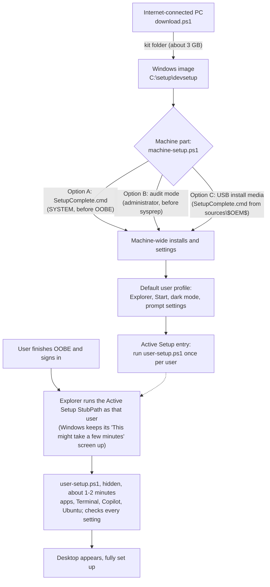

# Windows Dev Config: offline kit for OEM images

This kit sets up a new Windows PC the same way as the standard Windows Dev Config setup:

```powershell
irm https://aka.ms/devconfig/standard/setup.ps1 | iex
```

The difference is that everything is downloaded ahead of time. The PC needs **no network
access** during Windows setup or at first sign-in, and **the user never sees a setup window**.
The work happens while Windows shows its own setup screens: the machine part before OOBE, and the
per-user part behind Windows' first sign-in screen. When the desktop appears, the developer
tools, settings, Windows Terminal, PowerShell 7, the GitHub Copilot CLI, and WSL with Ubuntu are
already in place.

## What the user gets

The kit reproduces the standard setup (`-Action Partial`):

| Area | Result |
|---|---|
| Tools | Windows Terminal, Intelligent Terminal, PowerShell 7, Git, GitHub CLI, Azure CLI, GitHub Copilot CLI, VS Code, .NET 10 SDK, Python 3.14, VC++ Redistributable, uv, Node.js LTS, NVM for Windows, Coreutils, Oh My Posh, winapp CLI, PowerToys |
| WinGet | App Installer updated to the version the standard setup pins |
| System | Long paths enabled; Cascadia Code and Cascadia Mono Nerd Fonts installed |
| File Explorer | File extensions and hidden files shown, full path in title bar, opens to This PC, no frequent files/folders, no sync tips, Details pane state |
| Taskbar and Start | End Task on right-click, no Start recommendations, no account notifications |
| Look | Dark mode; Terminal uses PowerShell 7 and Cascadia Mono NF; Oh My Posh prompt |
| Copilot | GitHub Copilot profile in Terminal; win-dev-skills marketplace and WinUI plugin |
| WSL | WSL installed and Ubuntu registered; Ubuntu asks for a Linux user name the first time it opens |

## How it works



| File | Runs | Account | Network |
|---|---|---|---|
| `download.ps1` | Once, on a technician PC | Any user | Required |
| `machine-setup.ps1` | Once per device or image | SYSTEM or an administrator | Not used |
| `SetupComplete.cmd` | Windows runs it at the end of setup | SYSTEM | Not used |
| `build-media.ps1` | Optional (Option C), on the technician PC | Any user | Not used |
| `user-setup.ps1` | Once per user, at first sign-in, hidden | That user, never elevated | Not used |

Both setup scripts load the Microsoft-signed Windows Dev Config steps from the kit, so every
setting, check, and line of console output matches the online setup. Only downloads are replaced
with the files in the kit. Each step checks first, applies only what is missing, and checks again
afterwards, so running a script twice is safe.

## Requirements

**Technician PC (download):** Windows 10 or 11, internet access, WinGet 1.8 or later
(`winget --version`), and about 4 GB of free space.

**Target device:** Windows 11 x64 (pass `-Architecture arm64` to `download.ps1` for Arm64
devices). Virtualization must be enabled in the firmware so WSL 2 can run. Plan for about
3 GB for the kit and 8 GB for the installed tools.

## Step 1: Download the kit

On the internet-connected PC, from the folder that contains this README:

```powershell
powershell -NoProfile -ExecutionPolicy RemoteSigned -File .\download.ps1
```

- The kit is written to `C:\setup\devsetup`. Use `-Destination` to choose another folder.
- The script reads the current standard setup from `https://aka.ms/devconfig/standard/setup.ps1`,
  checks its Microsoft signature, and downloads the exact signed payload that it pins.
- The package list and pinned versions come from that payload, so the kit always matches what the
  online setup installs on the day you run it. Run it again to refresh the kit.
- Every installer is checked: WinGet verifies package hashes, the payload, WinGet, Cascadia, and
  Ubuntu are checked against pinned SHA-256 values, and the WSL MSI must be Microsoft-signed.
- If you downloaded these scripts with a browser, run `Unblock-File .\*.ps1` first.

The kit folder contains:

| Path | Contents |
|---|---|
| `devsetup.json` | The install plan: each package's file, SHA-256, silent switches, and how to detect it |
| `payload\` | The Microsoft-signed Windows Dev Config scripts |
| `packages\` | One folder per WinGet package (installer, manifest, and MSIX dependencies) |
| `winget\` | App Installer (WinGet) bundle, dependencies, and license |
| `fonts\` | Cascadia Code release |
| `wsl\` | WSL MSI and the Ubuntu image (`.wsl`) |
| `copilot\` | Terminal icon and an offline copy of the win-dev-skills marketplace with the WinUI plugin |
| `machine-setup.ps1`, `user-setup.ps1`, `_oem.ps1`, `SetupComplete.cmd`, `README.md` | The kit scripts and this guide |

## Step 2: Add the kit to the image

Choose one option for the machine part.

> **Important:** Windows does not run `SetupComplete.cmd` when the device uses an OEM product key,
> except on Enterprise editions
> ([Add a Custom Script to Windows Setup](https://learn.microsoft.com/windows-hardware/manufacture/desktop/add-a-custom-script-to-windows-setup)).
> For devices that ship with an OEM key, use **Option B**. Options A and C both depend on `SetupComplete.cmd`.

### Option A: offline servicing with SetupComplete.cmd

Use this for images without an OEM product key (for example Enterprise or volume-licensed
images). From an elevated command prompt, with the image index you ship:

```cmd
md C:\mount
Dism /Mount-Image /ImageFile:D:\images\install.wim /Index:5 /MountDir:C:\mount

robocopy C:\setup\devsetup C:\mount\setup\devsetup /E

md C:\mount\Windows\Setup\Scripts
copy C:\setup\devsetup\SetupComplete.cmd C:\mount\Windows\Setup\Scripts\SetupComplete.cmd

Dism /Image:C:\mount /Enable-Feature /FeatureName:VirtualMachinePlatform /All
Dism /Image:C:\mount /Enable-Feature /FeatureName:Microsoft-Windows-Subsystem-Linux /All

Dism /Unmount-Image /MountDir:C:\mount /Commit
```

- If the image already has a `SetupComplete.cmd`, add the lines from the kit's
  `SetupComplete.cmd` to it instead of replacing it.
- `SetupComplete.cmd` runs `machine-setup.ps1 -PerUserApps`. Windows removes MSIX app
  provisioning made during OOBE when it deletes its temporary setup account, so in this option the
  MSIX apps (Terminal, PowerShell 7, WinGet, Intelligent Terminal, Oh My Posh, winapp CLI) are staged
  and installed for each user at first sign-in from the local copy, the way the online setup
  installs them. Everything else is installed machine-wide.
- Turning the WSL features on in the image matters: `SetupComplete.cmd` cannot restart Windows,
  so features turned on there only start after the next restart. If you skip this, Ubuntu is
  added automatically at the user's next sign-in after a restart.
- `machine-setup.ps1` took about 9 minutes in a 4-core test VM; a second run takes about a
  minute. Use Option B to keep that time out of the customer's first boot.

### Option B: audit mode (recommended for factory images)

This installs the machine-wide tools on the reference PC before it is captured, so first boot is
not slower and the OEM product key does not matter.

1. Boot the reference PC into audit mode (press **Ctrl+Shift+F3** at the first OOBE screen, or use
   an answer file with `Microsoft-Windows-Deployment\Reseal\Mode = Audit`).
2. Copy the kit folder to `C:\setup\devsetup`.
3. From an elevated PowerShell:

   ```powershell
   powershell -NoProfile -ExecutionPolicy RemoteSigned -File C:\setup\devsetup\machine-setup.ps1
   ```

4. Restart (still in audit mode) so the WSL features finish turning on, then run the same command
   again. Every step should report `already OK`.
5. Generalize and capture as usual, for example `sysprep /generalize /oobe /shutdown`.

The audit-mode Administrator is skipped by `user-setup.ps1`; the per-user part runs for the
customer's account after OOBE. You do not need `SetupComplete.cmd` with this option.

### Option C: installation media (USB drive)

This is Option A delivered on bootable media: the same `SetupComplete.cmd` flow, so the same
OEM product key limit applies. It needs no DISM, no elevation, and no change to the Windows
image. From the folder that contains this README, after Step 1:

```powershell
powershell -NoProfile -ExecutionPolicy RemoteSigned -File .\build-media.ps1 `
    -IsoPath D:\iso\Win11_x64.iso -OutputPath D:\iso\Win11_x64_devsetup.iso
```

`build-media.ps1` copies the Windows ISO and adds:

| Path on the media | What Windows Setup does with it |
|---|---|
| `sources\$OEM$\$1\setup\devsetup\` | Copies the kit to `C:\setup\devsetup` |
| `sources\$OEM$\$$\Setup\Scripts\SetupComplete.cmd` | Copies it to `C:\Windows\Setup\Scripts\`, so the machine part runs as SYSTEM after setup |
| `autounattend.xml` | Turns on the WSL features during setup, so Ubuntu works at the first sign-in without a restart |

- Windows Setup and OOBE stay interactive. To automate them, pass your own answer file with
  `-AnswerFile`; `build-media.ps1` adds its WSL step to it.
- The ISO is about 10 GB and boots on UEFI PCs (Windows 11 requires UEFI).
- **Writing it to a USB drive:** `sources\install.wim` is larger than 4 GB, which FAT32 cannot
  hold. [Rufus](https://rufus.ie) handles this: select the ISO and keep its defaults (NTFS with
  its UEFI boot helper). Alternatively, split the image with
  `Dism /Split-Image /ImageFile:install.wim /SWMFile:install.swm /FileSize:3800` and copy the
  files to a FAT32 drive.
- Booting the ISO in a Hyper-V Gen 2 VM tests exactly what the USB drive does; see
  [Testing the kit in Hyper-V](#testing-the-kit-in-hyper-v).

Keep `C:\setup\devsetup` in the image until `machine-setup.ps1` has run. After that,
`machine-setup.ps1` has copied everything each user needs to `C:\ProgramData\CalmOS-Offline`, so
`C:\setup\devsetup` can be deleted to save about 3 GB.

> **Run the machine part before any user account exists.** Windows runs Active Setup entries only
> during a profile's *first* sign-in, so accounts that already signed in before
> `machine-setup.ps1` ran do not get the per-user part automatically. In both options above the
> customer's account is created later in OOBE, so this happens on its own (also in Option C). For an account that
> already exists, run the per-user command in [Troubleshooting](#troubleshooting) once.

## Step 3: What happens on the device

1. **Machine part** (SYSTEM via `SetupComplete.cmd`, or already done in audit mode):
   - Restricts `C:\setup` and the kit so only administrators and SYSTEM can change them (users can still read them), and refuses to run from a folder that other users could replace.
   - Installs the signed payload to `C:\ProgramData\CalmOS`, where the online setup also keeps it.
   - Provisions App Installer and the MSIX packages for every user (from `SetupComplete.cmd` it
     stages them for each user's first sign-in instead), runs the other installers machine-wide
     with silent switches, sets long paths, installs the fonts, turns on WSL, and installs the WSL
     MSI.
   - Writes the user's File Explorer, taskbar, Start, dark mode, Oh My Posh prompt, WSL, and
     PowerToys settings into the Default user profile, so every account Windows creates from it,
     including the one made in OOBE, starts with them.
   - Copies the per-user files to `C:\ProgramData\CalmOS-Offline` and registers
     `user-setup.ps1` with Active Setup. It never restarts Windows.
2. **OOBE:** the customer goes through OOBE as normal.
3. **First sign-in:** Explorer runs the Active Setup entry once for that user, hidden, and waits
   for it before it shows the desktop. Meanwhile Windows keeps its own "This might take a few
   minutes" screen up, so the user sees nothing from the kit:
   - It installs or registers Terminal, PowerShell 7, WinGet, and the other apps for this user
     (including their `pwsh`, `oh-my-posh`, and `winapp` commands), configures Terminal, adds the
     Copilot profile, marketplace, and WinUI plugin, and adds Ubuntu.
   - It checks every per-user setting from the standard setup and fixes any that Windows reset
     during the first sign-in (Windows resets dark mode, for example).
   - This took about 70 seconds in testing when the apps were provisioned for all users, and about
     2 minutes when `SetupComplete.cmd` left them to install per user.
   - If a step cannot finish yet, for example because WSL needs a restart, the script runs again,
     hidden, at the next sign-in (up to three times).
4. **Every later user** on the PC gets the same per-user setup, hidden, at their first sign-in.

If the PC is online at first sign-in, the Copilot marketplace is registered from GitHub exactly
like the online setup. Otherwise the kit's copy is used.

## Verify a device

| Check | Expected |
|---|---|
| `C:\ProgramData\CalmOS-Offline\machine-setup-result.json` | `"Completed": true` and an empty `Flagged` list |
| `%LOCALAPPDATA%\CalmOS\offline-user-setup-result.json` | `"Completed": true` and an empty `Flagged` list |
| `wsl --list` | `Ubuntu` |
| `git --version`, `gh --version`, `az version`, `code --version`, `dotnet --version`, `python --version`, `node --version`, `uv --version`, `copilot --version`, `pwsh --version`, `winget --version` | Each prints a version |
| Windows Terminal | Opens to PowerShell 7 in Cascadia Mono NF with the Oh My Posh prompt and a **GitHub Copilot** profile |

Logs:

| Log | Location |
|---|---|
| Machine part | `C:\ProgramData\CalmOS-Offline\machine-setup-log.txt` (MSI logs in `logs\`) |
| SetupComplete console output | `C:\Windows\Temp\devsetup-machine-setup.txt` |
| User part | `%LOCALAPPDATA%\CalmOS\offline-user-setup-log.txt` (same phases and check marks as the online setup) |

## Troubleshooting

- **Run the machine part again:** run the audit-mode command from an elevated PowerShell. Steps
  that are done report `already OK`.
- **Run the user part again** (signed in as that user, not elevated). Run from a console, it shows
  the same output it writes to its log:

  ```powershell
  powershell -NoProfile -ExecutionPolicy RemoteSigned -File C:\ProgramData\CalmOS-Offline\user-setup.ps1
  ```

- **Ubuntu is flagged:** restart the PC and sign in again. If it is still flagged, check that
  virtualization is enabled in the firmware.
- **"failed its SHA-256 check" or "failed Microsoft signature verification":** the kit was changed
  or copied incompletely. Download it again.
- **A package is flagged:** its installer log is in `C:\ProgramData\CalmOS-Offline\logs`, and its
  exit code is in `machine-setup-log.txt`.

## Differences from the online setup

- Tools are installed once for the whole PC instead of per user where the online setup would use
  per-user installers (VS Code, PowerToys, GitHub Copilot CLI, uv, and the MSIX apps).
- NVM for Windows is installed to `%ProgramFiles%\nvm`, so `nvm install` needs an administrator.
- PowerToys is installed machine-wide. Because the PowerToys installer registers its identity package
  without its app folder when it runs as SYSTEM, the per-user part registers that package again for
  each user, so PowerToys Settings, Advanced Paste, and the Command Palette extension work.
- Coreutils' `ls`-style command hook is added to each user's PowerShell 7 profile with Coreutils'
  own script at first sign-in. Recording that profile for the Coreutils uninstaller needs an
  administrator, so uninstalling Coreutils leaves the hook in those profiles.
- WinGet does not list the GitHub Copilot CLI or Python as WinGet installs, so `winget upgrade`
  does not update them. Both work: Copilot CLI updates itself, and Python's main uninstall entry
  belongs to the SYSTEM account that installed it.
- Versions are the ones current when `download.ps1` ran. The apps update themselves, or with
  `winget upgrade --all`, once the PC is online.
- When the PC is offline at first sign-in, the win-dev-skills marketplace points at the copy in
  `C:\ProgramData\CalmOS-Offline\copilot`. To switch it to GitHub later, run
  `copilot plugin marketplace remove win-dev-skills` and then
  `copilot plugin marketplace add microsoft/win-dev-skills`.
- There are no windows, UAC prompts, or restarts, and the Terminal font applies right away instead
  of at the next sign-in. The first sign-in takes 1-2 minutes longer behind Windows' own screen.

## Testing the kit in Hyper-V

`src/tests/oem/hyperv-e2e.ps1` in the Windows Developer Config repository runs the whole flow in a
virtual machine with no network adapter. It needs membership in the Hyper-V Administrators group,
not elevation:

```powershell
.\src\tests\oem\hyperv-e2e.ps1 -IsoPath D:\iso\Win11_x64.iso -KitPath C:\setup\devsetup

# Option C: build the installation media with build-media.ps1 and boot only that ISO
.\src\tests\oem\hyperv-e2e.ps1 -IsoPath D:\iso\Win11_x64.iso -KitPath C:\setup\devsetup -UseMedia
```

It installs Windows unattended from the ISO, applies the Option A image changes during setup,
completes OOBE with a local account, signs in once, and then saves screenshots, logs, and a
`verify.json` report. `src\tests\oem\unit.ps1` runs in seconds and fails if the standard setup
gains a step the kit does not cover.

The kit has been run this way on Windows 11 Pro (x64) with no network: Windows Setup,
`SetupComplete.cmd`, OOBE, and the first sign-in of both administrator and standard accounts, with
the Microsoft Defender definitions that ship in the image.
